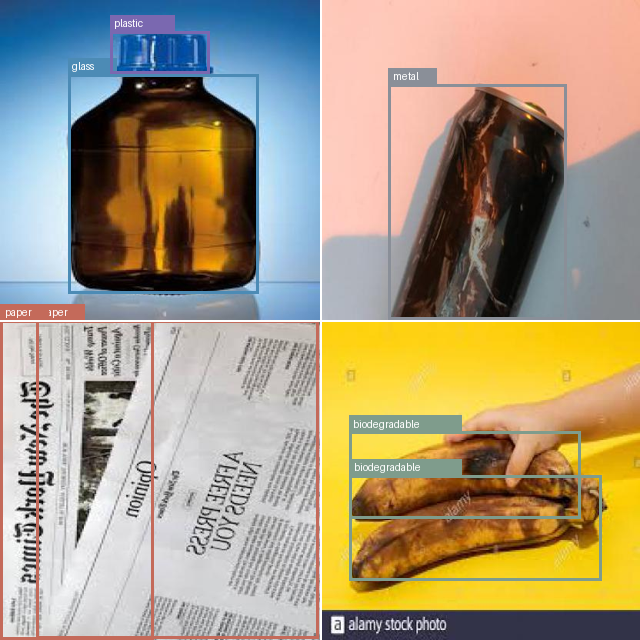

# Task 1 – Dataset Analysis & Training Pipeline

Garbage Detection Dataset · YOLOv5s · Computer Vision Portfolio 1, Assignment 1

## Our pipeline

```
 Data  →  Analysis  →  Split  →  Augment  →  Model  →  Train  →  best.pt
10,464   imbalanced   stratified  640·flip   YOLOv5s   70 epochs  best val
images   & crowded    70/15/15    ·mosaic    pretrained patience 15 mAP
```

Click a section to open it.

---

<details>
<summary><b>1. The data</b></summary>

- **10,464 images**, Roboflow export in YOLO format (`images/` + `labels/`)
- **6 classes:** 0 biodegradable · 1 cardboard · 2 glass · 3 metal · 4 paper · 5 plastic
- One label file per image; **one line = one object** (`class x_center y_center width height`, values 0–1)
- **74,090 labelled objects** in total
- Class names identified from the file-name prefixes (e.g. `paper1543_...txt` → lines start with `4`)
- Quality check: every image has a label file, 0 empty labels, 0 corrupt labels

</details>

<details>
<summary><b>2. What we found</b></summary>

| Class | Boxes | Share |
|---|---|---|
| biodegradable | 45,407 | 61.3 % |
| glass | 7,809 | 10.5 % |
| plastic | 5,945 | 8.0 % |
| metal | 5,841 | 7.9 % |
| cardboard | 4,698 | 6.3 % |
| paper | 4,390 | 5.9 % |

- **Strong class imbalance:** biodegradable has about **10×** more objects than paper
- **Busy scenes:** about **7 objects per image** (74,090 ÷ 10,464), many small or overlapping
- Some images are single close-ups (one object filling most of the frame)

</details>

<details>
<summary><b>3. How the findings shaped the pipeline</b></summary>

| Finding | Decision |
|---|---|
| Class imbalance | Stratified split + **per-class** evaluation |
| ~7 objects per image, many small | Image size **640** + **mosaic** augmentation |
| Colour separates materials (cardboard / paper / glass) | Only light colour augmentation, no greyscale |

</details>

<details>
<summary><b>4. Stratified split (70 / 15 / 15)</b></summary>

- **Train** 7,322 images · **Validation** 1,568 · **Test** 1,574 (sum 10,464 ✓)
- **Rarest-class rule:** each image is assigned to the pile of the rarest class it contains (rarity measured over the whole dataset: paper < cardboard < metal < plastic < glass < biodegradable)
- Each pile is shuffled (**seed 42**) and split 70/15/15; leftover images from rounding go to test
- Result: every class appears in all three splits with similar shares (biodegradable 60–64 %, others 5–11 %); paper still has 653 boxes in test
- Limitation: at box level the split is ~66/17/17, because val/test received slightly more crowded images
- Code: `split.py` (split) · `check_split.py` (per-class check)

</details>

<details>
<summary><b>5. Preprocessing & augmentation</b></summary>

| Step | Setting | Why |
|---|---|---|
| Resize | 640 × 640 (letterbox) | keeps small objects visible; divisible by 32 |
| Horizontal flip | 50 % | a mirrored object still looks realistic |
| Vertical flip | off | upside-down scenes are unrealistic |
| Colour | light brightness/saturation only | simulate lighting; keep colour as a material cue |
| Mosaic | on | 4 images → 1, teaches small and crowded objects |

Augmentation is applied to training images only.

**Mosaic augmentation:** 4 training images are shrunk and joined into one image; each box moves with its object.

```
 ┌───────┐ ┌───────┐ ┌───────┐ ┌───────┐            ┌───────┬───────┐
 │ glass │ │ metal │ │ paper │ │ bio   │    ──►     │ glass │ metal │
 └───────┘ └───────┘ └───────┘ └───────┘            ├───────┼───────┤
   4 separate training images                       │ paper │ bio   │
                                                    └───────┴───────┘
                                          1 mosaic: smaller objects, busier scene
```

Real example from our training data (made with `make_mosaic.py`):




</details>

<details>
<summary><b>6. Model choice</b></summary>

- **YOLOv5s** (Ultralytics), a one-stage detector covered in detail in the lecture
- Architecture: CSP backbone → FPN/PAN neck → detection head at 3 scales (80×80, 40×40, 20×20) → NMS
- Size **s**: good balance of accuracy and training time (one night on a Colab T4 GPU)
- **COCO-pretrained (transfer learning):** 343 of 349 weight tensors transferred; only the 6 detection-head tensors were re-initialised (80 COCO classes → 6 classes)
- **AutoAnchor:** 0.999 best possible recall, so the default anchors fit our boxes

</details>

<details>
<summary><b>7. Training settings</b></summary>

| Setting | Value | Why |
|---|---|---|
| Epochs | 70 | enough for a pretrained model to converge |
| Batch size | 16 | fits safely in GPU memory |
| Image size | 640 | see above |
| Early stopping | patience 15 | stop when validation mAP stops improving; avoid overfitting |
| Checkpoint | `best.pt` | epoch with the highest validation mAP |
| Seed | 42 | reproducible results |

```bash
python train.py --img 640 --batch 16 --epochs 70 --patience 15 \
  --data GarbageSplit/data.yaml --weights yolov5s.pt --seed 42
```

</details>

<details>
<summary><b>8. Files</b></summary>

- `label.py` – class counts (data analysis)
- `split.py` – stratified 70/15/15 split
- `check_split.py` – per-class distribution of each split
- `GarbageSplit/data.yaml` – dataset config for YOLOv5
- `make_mosaic.py` – builds `mosaic_example.png` from 4 real training images
- `task1_overview.html` – visual overview of this documentation

</details>
